# tmbilling — Architecture

> **Canonical architecture doc.** For *how to build* (conventions, golden path, verify gates) see
> [`GUIDE.md`](./GUIDE.md).

## 1. What tmbilling is

`tmbilling` is a **standalone, multi-tenant subscription billing platform**, sold as a product from day
one. Product goals, in priority order: (1) simple for
subscription businesses — sane defaults, clean mental model; (2) a real, well-documented API
with Stripe-quality DX; (3) easy migration in — built-in importers with a reconcile step; (4)
provider-agnostic — Stripe, RazorPay, PayPal (and more) interchangeably; (5) automatic
subscription management — renewals, proration, dunning, all hands-off. The initial build
program (backend phases 0→H + dashboard) is complete.

---

## 2. Locked decisions (ADRs)

These are decided. Don't re-litigate without a written reason here.

### ADR-001 — The billing engine owns subscription state. Providers are dumb executors.
The engine is the **source of truth** for plans, prices, subscriptions, proration, invoices, and
the ledger. Payment providers do exactly two things: **(a)** execute a charge/refund against a
saved payment method, **(b)** vault payment methods + emit payment webhooks. We never create
subscriptions or invoices inside a provider.
- **Why:** the only common denominator across providers is "charge this amount." Their
  subscription models are mutually incompatible; delegating subscription logic would make the
  abstraction leak immediately and make migration impossible.
- **Consequence:** we implement subscription logic ourselves — the bulk of the
  real engineering, and the whole reason the product can exist.

### ADR-002 — Modular monolith, TypeScript/Node, Postgres.
One deployable service with clean internal module boundaries that *could* be split later.
- **Why:** a single renewal touches subscription + invoice + ledger + payment in one DB
  transaction. Microservices early would shatter that transactional integrity for no benefit.
- **ADR-010 (2026-09-21) amended this for reads; ADR-011 (2026-09-22) reverses that.** Nine
  engines were evaluated against the production book; each failed on tenancy or licence, and none
  sped up the reports as written. Reporting stays in Postgres, and the slow reports are fixed by
  moving their fold into SQL.

### ADR-003 — Multi-tenancy: shared DB + `organization_id` + Postgres Row-Level Security (RLS).
Every tenant-owned row carries `organization_id` (the HARD isolation boundary, enforced by RLS)
plus `business_id` where it belongs to a business.
- **Why:** standard for billing SaaS, simplest ops, scales far. The org→business split lets one
  account run separate billing units (own catalog, currency, payment provider). DB-per-org is a
  later enterprise/compliance add-on, not a default.
- **How it is enforced (D3, 2026-10-21):** org-scoped work runs in `withTenant`, which switches to
  `tmbilling_app` (no BYPASSRLS) with `app.org_id` set. The app logs in as `tmbilling_system`
  (no superuser, owns nothing); work that spans orgs uses the named `systemDb`, whose importers
  are an allowlist. `verify:rls` checks from the catalog that every org-keyed table has a policy
  and that the app role reaches no unfiltered table; migrations run as the owner.

### ADR-004 — Money lives in a double-entry, append-only ledger.
Every invoice, payment, refund, credit, and proration is recorded as immutable double-entry
ledger entries. Balances are *derived* from the ledger, never stored-and-mutated.
- **Why:** auditability and correctness. You never "edit" money; you post a compensating entry.

### ADR-005 — Idempotency everywhere.
Every external API write accepts an `Idempotency-Key`; every inbound provider webhook is
deduplicated by provider event id. Replays are safe by construction.

### ADR-006 — A durable "billing clock".
Time-based work (renewals, trial-ends, dunning retries, scheduled changes) runs as durable,
replayable jobs in a Postgres-backed queue (graphile-worker) — never in-memory timers.

### ADR-007 — Outbound webhooks via the outbox pattern.
Write the event in the same transaction as the state change (the "outbox"), then deliver + retry
asynchronously with signatures. Refined by ADR-009.

### ADR-008 — Providers vault cards → we stay PCI SAQ-A.
Raw card data is captured by the provider's hosted fields/SDK and tokenized; tmbilling only ever
stores provider tokens. We never touch a PAN.

### ADR-009 — Events are the primary primitive; webhooks are a subscriber on top. (BUILT 2026-07-12)
The **event** is the first-class resource (every state change emits a stored
event carrying a full snapshot of the affected resources); **webhook delivery** is one downstream
consumer. As built: `src/modules/events/emit.ts` owns `emitEvent` (persists the immutable event
row and returns it) + `registerEventSink`; webhooks registers `enqueueDeliveries` as a sink at
the composition roots (`src/index.ts`, `src/platform/jobs.ts`) — event + deliveries commit in
one tx (outbox guarantee preserved). Dependency rule: webhooks → events, never the reverse;
events → platform only. Event types are **snake_case** (`subscription_created`, `invoice_paid`);
event `content` embeds **full serialized resource snapshots** (each with an
`object` discriminator) per category, e.g. `invoice_*` → `invoice` + `customer` (+
`subscription`). The webhook body is the event object verbatim:
`{id, occurred_at, source, user, event_type, api_version, content, object:'event'}`.

---

### ADR-010 — Reporting reads from a columnar analytics store. Billing truth stays in Postgres. (2026-09-21) — SUPERSEDED by ADR-011

> ⚠️ **Superseded 2026-09-22.** Its premise did not survive measurement: the eight reports it was
> justified by are slow because they fold rows in the application, not because of storage, and the
> engine swap it describes never reached them. Kept for the reasoning; see ADR-011 for the evidence.

**Amends ADR-002**, which says Postgres and nothing else. That decision stands for every byte of
billing truth and is not reopened here: subscriptions, invoices, the ledger, the clock and the
outbox remain Postgres, under RLS, and no figure in this store is ever written back.

**The problem.** Reporting has been served from `metric_daily` (0267) — a pre-aggregate keyed by
(business, grain, period, measure, dimension, currency). It is the right shape for what it holds,
and its own schema header states the limit: an audit of all 97 report keys found **eight this shape
cannot hold**, because a retention cohort and a movement waterfall carry two dimensions at once, and
customer concentration, top customers and MRR bands need a ranking or band edges chosen at read
time. Those eight keep a JavaScript reconstruction measured at **3.5 s on a 74,534-subscription
book**.

The same wall stopped segmentation. A pre-aggregate can be cut only by dimensions chosen before the
question was asked, so an arbitrary customer predicate over a STOCK series has two bad answers: a
snapshot row per user-defined segment (rows multiply by a number the user picks) or a live
reconstruction (the thing the snapshots exist to avoid). The pre-aggregate route was taken as far as
it goes — a bounded `country` dimension, and a named refusal for anything else.

**The decision.** A columnar store holds the same facts at **per-subscription daily grain**, plus
the movement ledger, invoices, transactions and a customer dimension. At that grain a segment is a
join, a cohort is an aggregate, and a ranking is an `ORDER BY` — none of them needing a dimension
chosen in advance. On the production book the largest table is ~27M rows a year, which is small for
a columnar engine and unpleasant for a row store already serving billing.

**What holds it honest**, and these are the load-bearing parts of the decision:

1. **Derived, never authoritative.** Every row is reproducible from Postgres, and losing the
   database costs a rebuild and nothing else. It is the same rule `metric_daily` and
   `mrr_snapshots` already follow — **including the same caveat**, which is worth stating
   precisely rather than overselling the guarantee: a day SYNCED AS IT CLOSED is reproducible
   exactly, while a day REBUILT FROM HISTORY is rated at the subscription's current composition,
   because no composition history is stored on either engine. So a rebuild reproduces what the
   Postgres backfill would produce, not necessarily what was stored months ago. Fixing that means
   a movement-derived historical rate, and it has to land on both engines in one change.
2. **One equality gate, not a migration of faith.** `ANALYTICS_ENGINE` selects the engine, and
   `verify:olap-equivalence` runs the whole catalogue on both and asserts equality **in integer
   minor units**. Postgres resolvers are deleted only once that is green on a production-shaped
   book.
3. **Tenancy is code here, and that is a downgrade to be defended, not ignored.** ADR-003 makes a
   cross-tenant read structurally impossible; this engine has no RLS and will refuse nothing. So
   every query is built by one gateway that takes the tenant as a required argument, no SQL exists
   outside it, and `verify:olap-isolation` mutation-tests the predicate — remove it and the gate
   must go red.
4. **Money is Int64 minor units.** No `Decimal`, no `Float`, and JSON 64-bit integers are quoted on
   the wire, because past 2^53 a JSON number drops the low digits of a total in cents.
5. **A day here is the business's local day**, cut by the same helper the Postgres cron uses.
   Otherwise the two engines answer different questions and the equality gate is comparing
   different windows.

**Cost accepted.** A second engine to operate, a sync that can lag (so every screen states the
figure's age rather than implying freshness), and an attribute dimension that holds customers **as
they are today** — re-segmenting history needs attribute versioning and is deliberately not
pretended at.

**Not yet decided: where it runs in production.** Local development and CI only for now
(`docker-compose.analytics.yml`), with the engine flag defaulting to `postgres`. A 4-core box
already carrying Postgres, with no swap, needs either a memory cap set against a measurement or its
own host — and that is a sizing decision, not an architectural one.

---

### ADR-011 — Reporting stays in Postgres. The fold moves into SQL, not onto another engine. (2026-09-22)

**Supersedes ADR-010.** No columnar analytics store is adopted. The analytics module
(`src/modules/metrics/olap/`, its sync job, its gates and the ClickHouse client) was removed on
2026-09-23, before the first open-source release, so none of it ships.

**What we measured.** Nine engines, each against a copy of the production book — 74,574
subscriptions, 1 GB — through the application's own `resolveReport`, with a row-store baseline taken
inside each candidate's own container so the delta controls for hardware. The bar is 6,136 ms for
the eight slowest reports.

| | result | tenancy | licence |
| --- | --- | --- | --- |
| ClickHouse | **76x slower** on the measures API — it recomputed raw facts while Postgres read pre-aggregates; rebuild never finished | code, not RLS | Apache-2.0 |
| Citus columnar | 48% slower | survives | AGPL-3.0 |
| duckgres | 32.6% slower | **silently simulated** | MIT |
| Hydra | 8.6% slower | survives | AGPL-3.0 |
| pg_duckdb | **not measured** — it refuses RLS tables and fell back to Postgres | survives | MIT |
| TimescaleDB | 3.8% faster, inside a 2.1% noise floor | impossible with compression | TSL |
| Native DuckDB | 12.4% faster — **projected** from per-query ratios, not run end to end | none | MIT |
| pg_mooncake | not benchmarked | **fails open** | BSL 1.1 |
| Materialized views | **~36% faster** | solvable, fails closed | PostgreSQL |

⚠️ **What these speed figures do NOT show (corrected 2026-09-23).** The comparison was not like for
like. Every engine but the materialized view ran the reports unchanged — fetch rows, fold them in
Node — and the figures are end-to-end, so about 73% of each is JavaScript that is identical on every
engine. Only the materialized view was given the aggregation in SQL. No engine was timed on the same
aggregating query, so this table ranks nothing on aggregation speed and must not be quoted as
"Postgres is faster than a column store". The decision rests on tenancy, licence and operational
simplicity, which were each tested directly; a same-query, engine-only comparison was scoped and
deliberately not run.

**Why ADR-010 was wrong, and it was not a close call.** It assumed the eight hard reports were slow
because a row store could not serve them. Capturing every statement they issue shows otherwise: 127
statements, **1,412 ms of SQL**, and **3,894 ms — 73% — of JavaScript** folding the results. The
reports fetch about **250,000 rows to compute eight headline numbers**. Almost none of that SQL
aggregates; it is six bulk row-fetch shapes.

That is the worst possible shape for a column store — with no aggregation in the query, column
pruning and vectorised execution never engage — and it is why every candidate lost or barely moved.
duckgres settles it directly: it is the one engine our real code path ran against end to end, and it
was slower, because it adds a wire hop and a transpiler pass to many small row-shipping queries.

⚠️ **ADR-010 also described a swap that never existed.** `resolve.ts` contains no reference to the
analytics store; the engine flag is read in exactly one place, inside `readMetric`. The measure
coverage and its equivalence gate were always statements about a different surface, and the eight
reports it was justified by were never served by it.

**Tenancy and licence decided it, and they are why ADR-003 holds.** Three candidates failed on it.
pg_mooncake fails open. TimescaleDB refuses compression and row security together, in both
directions, and leaves the policy listed in `pg_policies` while `relrowsecurity` is false — an audit
reading that catalogue would report isolation intact over a table that returns every tenant's rows.
duckgres is worse: `SET LOCAL ROLE` returns a success tag and is discarded, so `withTenant` would
appear to work while every query returned every organization's book. Postgres fails closed; the
alternatives fail open, and two of them do it invisibly.

**What we do instead.** Move the fold into SQL. Shipped: the two movement summaries read
`mrr_movement_summary_mv` (0273), ~1.2 s → ~130 ms on the production book with every figure equal;
the five live-book and churn-age reports filter or aggregate in plain SQL, ~0.5 s → 20–85 ms. The
analysis that led there: A materialized view of the MRR movement
waterfall turns the two movement summaries from 2,203 ms into single-digit milliseconds — the whole
history collapses to 232 rows — refreshed concurrently in 167 ms, holding only `AccessShareLock` on
the ledger so it blocks no writer. A materialized view cannot carry RLS, so the tenant predicate
lives in a plain **definer-rights** view over it, with the matview revoked from the app role.

⚠️ `security_invoker = true` is the wrong shape and leaks: it checks the invoker's privileges, so
the app role must be granted SELECT on the matview, and that grant is the bypass — measured at
380,706 rows across both tenants with no tenant set.

**Two Postgres-side fixes found on the way, both larger than any engine offered.** `zonedDayString`
built a new `Intl.DateTimeFormat` per call: 80 us against 0.68 us for the UTC path, a 118x penalty
paid only by non-UTC businesses, and production is Asia/Kolkata. Cached, it is 19x, and the
analytics sync's 163 million calls fall from 218 minutes to 11. Separately, the pre-aggregate held
401 days while a 12-month report with a comparison needs about 730, so the comparison window was
reconstructed from raw subscriptions; backfilling took `total_mrr` from 2,998 ms to 821 ms.

**What this does not change.** ADR-002 (Postgres) and ADR-003 (RLS) stand, unamended. The
equivalence gate is worth keeping whatever happens to the analytics module: it compares two row
sources in integer minor units and will hold any future change to the read path.

## 3. Account hierarchy & tenancy

**Organization → Business → Customer → Subscription.**

- **Organization** — the tmbilling account. Holds API keys (`test | live | all`) and webhook
  endpoints. `organization_id` is the hard isolation boundary, enforced by Postgres RLS via
  `withTenant` (`src/platform/db`).
- **Business** — an org has many, each independent: own catalog, currency set, gateway accounts,
  settings, invoice numbering, per-business FX rates for reporting. A business is **wholly test
  or wholly live** (immutable); API-key mode is enforced centrally in auth; test businesses get
  time travel (virtual clock) and an auto-provisioned TM Test Gateway.
- **Customer** — the business's customer, the payer. Owns contacts, vaulted payment methods
  (with primary/backup roles), payment intents, and three derived per-currency balances.
- **Subscription** — multi-item; belongs to a customer.

Auth: `Authorization: Bearer <api_key>` resolves an organization; all queries are
organization-scoped + RLS; business-scoped resources take a `business_id`. Every
customer-facing object has a stable public id (`sub_…`, `inv_…`, `cus_…`) distinct from the
internal UUID PK — Stripe-style, safe to expose, migration-stable. **Exception:** catalog + coupon resources (product groups, products, prices, coupons, coupon sets)
use **user-provided human-readable slug ids** (`^[a-z0-9][a-z0-9._-]{1,99}$`, unique per
business, immutable, auto-slugified from name when omitted) — this is what lets configuration
transfer reference the same object across test and live businesses.

---

## 4. System diagram

<!-- BEGIN GENERATED: architecture-mermaid -->
_Generated from [architecture.json](architecture/architecture.json). Arrows point at dependencies._

```mermaid
flowchart TD
  subgraph layer_foundation["Foundation modules"]
    audit["audit"]
    auth["auth"]
    comments["comments"]
    emails["emails"]
    events["events"]
    hubspot["hubspot"]
    integrations["integrations"]
    ledger["ledger"]
    list_views["list-views"]
    ops["ops"]
    request_log["request-log"]
    tenancy["tenancy"]
    webhooks["webhooks"]
  end
  subgraph layer_catalog["Catalog & pricing"]
    catalog["catalog"]
    coupons["coupons"]
    custom_fields["custom-fields"]
    entitlements["entitlements"]
    reason_codes["reason-codes"]
    tax["tax"]
  end
  subgraph layer_customer["Customers & balances"]
    checkout["checkout"]
    credit_notes["credit-notes"]
    credits["credits"]
    customer_portal["customer-portal"]
    customers["customers"]
    metadata_rules["metadata-rules"]
    segments["segments"]
    usage_controls["usage-controls"]
    wallet["wallet"]
  end
  subgraph layer_billing["Subscriptions & billing"]
    dunning_policies["dunning-policies"]
    invoicing["invoicing"]
    metering["metering"]
    metrics["metrics"]
    model_prices["model-prices"]
    subscriptions["subscriptions"]
    team_alerts["team-alerts"]
  end
  subgraph layer_payments["Payments & gateway"]
    disputes["disputes"]
    gateway["gateway"]
    payment_intents["payment-intents"]
    payment_methods["payment-methods"]
    payment_requests["payment-requests"]
    payments["payments"]
    receipts["receipts"]
    refunds["refunds"]
    transactions["transactions"]
  end
  subgraph layer_tooling["Ops tooling"]
    migration["migration"]
    time_travel["time-travel"]
    transfer["transfer"]
  end
  auth --> tenancy
  emails --> events
  emails --> customers
  emails --> invoicing
  hubspot --> events
  hubspot --> customers
  integrations --> events
  integrations --> hubspot
  list_views --> audit
  list_views --> custom_fields
  ops --> subscriptions
  tenancy --> audit
  tenancy --> gateway
  webhooks --> audit
  webhooks --> events
  webhooks --> invoicing
  webhooks --> ledger
  webhooks --> payments
  webhooks --> subscriptions
  webhooks --> transactions
  catalog --> audit
  catalog --> events
  catalog --> webhooks
  coupons --> catalog
  coupons --> events
  coupons --> webhooks
  entitlements --> events
  checkout --> catalog
  checkout --> customers
  checkout --> payment_methods
  checkout --> subscriptions
  checkout --> emails
  checkout --> metadata_rules
  credit_notes --> customers
  credit_notes --> events
  credit_notes --> invoicing
  credit_notes --> ledger
  credit_notes --> refunds
  credit_notes --> webhooks
  credits --> customers
  credits --> events
  credits --> invoicing
  credits --> ledger
  credits --> metering
  credits --> webhooks
  customer_portal --> payment_methods
  customer_portal --> customers
  customer_portal --> invoicing
  customer_portal --> checkout
  customers --> events
  customers --> invoicing
  customers --> ledger
  customers --> payment_methods
  customers --> webhooks
  customers --> metadata_rules
  metadata_rules --> tenancy
  segments --> customers
  segments --> custom_fields
  segments --> metrics
  segments --> subscriptions
  usage_controls --> catalog
  usage_controls --> credits
  usage_controls --> customers
  usage_controls --> emails
  usage_controls --> events
  usage_controls --> invoicing
  usage_controls --> metering
  usage_controls --> payment_methods
  usage_controls --> payments
  usage_controls --> subscriptions
  usage_controls --> webhooks
  wallet --> customers
  wallet --> events
  wallet --> gateway
  wallet --> invoicing
  wallet --> ledger
  wallet --> payments
  wallet --> transactions
  wallet --> webhooks
  dunning_policies --> audit
  dunning_policies --> events
  dunning_policies --> subscriptions
  invoicing --> audit
  invoicing --> catalog
  invoicing --> coupons
  invoicing --> credit_notes
  invoicing --> customers
  invoicing --> events
  invoicing --> gateway
  invoicing --> ledger
  invoicing --> metering
  invoicing --> payment_methods
  invoicing --> subscriptions
  invoicing --> tax
  invoicing --> transactions
  invoicing --> webhooks
  metering --> catalog
  metering --> subscriptions
  metrics --> catalog
  metrics --> metering
  model_prices --> metering
  model_prices --> catalog
  model_prices --> emails
  subscriptions --> audit
  subscriptions --> catalog
  subscriptions --> coupons
  subscriptions --> credit_notes
  subscriptions --> customers
  subscriptions --> events
  subscriptions --> invoicing
  subscriptions --> ledger
  subscriptions --> metering
  subscriptions --> metrics
  subscriptions --> tax
  subscriptions --> webhooks
  subscriptions --> metadata_rules
  team_alerts --> tenancy
  team_alerts --> invoicing
  team_alerts --> webhooks
  team_alerts --> emails
  disputes --> audit
  disputes --> events
  disputes --> ledger
  gateway --> events
  gateway --> webhooks
  payment_intents --> events
  payment_intents --> gateway
  payment_intents --> invoicing
  payment_intents --> ledger
  payment_intents --> transactions
  payment_intents --> webhooks
  payment_methods --> events
  payment_methods --> webhooks
  payment_requests --> customers
  payment_requests --> events
  payment_requests --> gateway
  payment_requests --> invoicing
  payment_requests --> ledger
  payment_requests --> payments
  payment_requests --> receipts
  payment_requests --> transactions
  payments --> events
  payments --> invoicing
  payments --> ledger
  payments --> subscriptions
  payments --> wallet
  payments --> webhooks
  receipts --> customers
  receipts --> events
  receipts --> invoicing
  refunds --> events
  refunds --> ledger
  refunds --> transactions
  refunds --> webhooks
  transactions --> events
  transactions --> payments
  transactions --> webhooks
  migration --> catalog
  migration --> coupons
  migration --> customers
  migration --> invoicing
  migration --> ledger
  migration --> metrics
  migration --> subscriptions
  migration --> wallet
  transfer --> audit
  transfer --> auth
  transfer --> catalog
  transfer --> coupons
  transfer --> customers
  transfer --> emails
  transfer --> invoicing
  transfer --> tax
```


<!-- END GENERATED: architecture-mermaid -->

Machine-readable module graph: [`architecture/architecture.json`](./architecture/architecture.json). Interactive
visualizations: [`architecture.html`](./architecture/architecture.html) (every module, generated from the
JSON by [`visualize-architecture.py`](./architecture/visualize-architecture.py)) and
[`architecture-flow.html`](./architecture/architecture-flow.html) (money and state flows, drawn by hand).

---

## 5. Domain model

```
Organization (the tmbilling account — holds API keys; HARD isolation boundary = organization_id)
 ├─ ApiKey (test | live | all)
 ├─ WebhookEndpoint (per-endpoint event_types[] subscription)
 └─ Business (many; each independent — own catalog, currencies, gateways, settings;
     │        wholly test OR live; per-business exchange_rates for reporting FX)
     ├─ GatewayAccount (many; encrypted creds; router picks by currency × method type)
     ├─ TimeTravel (test businesses only — virtual clock)
     ├─ Customer (the payer)
     │   ├─ Contact (extra recipients)
     │   ├─ PaymentMethod (vaulted token @ a Provider; role: primary|backup; status lifecycle)
     │   ├─ PaymentIntent (on-session 3DS/SCA)
     │   ├─ Balances (derived, per-currency): promotional · refundable · excess payment
     │   ├─ Subscription (multi-item; status: future|in_trial|active|non_renewing|paused|cancelled)
     │   │   ├─ SubscriptionItem ── Price (× quantity; price_snapshot frozen at attach)
     │   │   ├─ ScheduledChange (future change|cancel|pause|resume)
     │   │   └─ UnbilledCharge (deferred mid-cycle charges)
     │   ├─ Invoice (status: pending|posted|payment_due|not_paid|paid|voided; dunning_status)
     │   │   ├─ InvoiceLineItem (recurring | proration | usage | one-time | rounding)
     │   │   ├─ Transaction (auth|payment|refund; gateway-facing log) ─ Payment ─ Refund
     │   │   └─ CreditNote (kind: adjustment|refundable) ─ CreditNoteAllocation
     │   ├─ UsageRecord ── SubscriptionItem (for metered prices)
     │   └─ Discount ── Coupon (stackable; item constraints) / CouponSet ─ CouponCode
     └─ Catalog (business-scoped; slug ids, immutable once referenced):
         ProductGroup
          └─ Product (kind: plan | addon | charge; applicability; attached_items)
              └─ Price (model: flat|per_unit|tiered|volume|package|percentage|usage|stairstep;
                        interval; currency; trial; tiers[]; differential per parent plan)

Money system (append-only):
 LedgerEntry  (organization_id + business_id; double-entry; references the source object)
 Event        (immutable log w/ source+actor+content snapshots → feeds webhook deliveries)
 AuditLog     (append-only actor/diff on writes) · ClockTick (billing-clock observability)
```

**Key modeling choices**
- **Product + Price**, not a monolithic "Plan". A subscription has many `SubscriptionItem`s,
  each `Price × quantity` — one shape expresses flat recurring, per-seat, usage-based, and
  tiered + add-ons.
- **Status enums are explicit state machines**, never free-form strings.
- **Price snapshots** frozen at attach (instead of plan versioning); we also keep extra pricing models (usage, package, percentage, stairstep).
- All money is integer **minor units** + ISO currency code. Never floats.

### 5.1 Money primitives (foundational tables)
- **`ledger_entries`** — append-only double-entry: `(organization_id, business_id,
  transaction_id, account, direction[debit|credit], amount_minor, currency, source_type,
  source_id, created_at)`. No `UPDATE`/`DELETE` ever.
- **`idempotency_keys`** — `(tenant_id, key, request_fingerprint, response_snapshot, status)`;
  one logical effect per key.
- **`events`** — immutable event log (the outbox source; `api_version` column).
- **`webhook_deliveries`** — per-endpoint delivery attempts with retry/backoff + signature.
- **Jobs** — graphile-worker: cron for the billing clock, plus transactional `addJob` enqueues
  that commit atomically with state changes.

---

## 6. Core flows

### 6.1 The billing clock (the engine loop)
`billing_clock_tick` (graphile-worker cron, every minute): apply scheduled changes →
`runBillingClockTick` (renewals) → `runDunningPass` → `deliverPending` (webhooks); observed via
`clock_ticks`. For each subscription whose period has ended: roll the term forward (decrement
`remaining_billing_cycles`), then generate the invoice through the ordered pipeline
(`billSubscriptionPeriod`):

```
assemble lines (recurring + prorations + usage arrears + unbilled-charge sweep)
  → stacked coupon discounts + promotional credits (PRE-tax)
  → tax per line + withholding
  → optional round-off
  → apply refundable credits + excess payments (POST-tax)
  → Net-D due date → ledger postings → collect (if auto_collection) → dunning on failure
```

Test businesses run this loop against a virtual clock (`businessNow()` seam — Time Travel:
`start_afresh` / `travel_forward`).

### 6.2 Subscription lifecycle
Statuses: `future | in_trial | active | non_renewing | paused | cancelled`.
Scheduled changes are a proper table (`cancel|pause|resume|change`, effective_at). Built:
`remaining_billing_cycles` → auto non_renewing; full cancel/pause/resume **option sets**
(credit/unbilled/AR/refundable handling, reason codes); `change_term_end`; proration on
upgrade/downgrade/quantity change (credit unused portion + charge new, pro-rata — both sides are
invoice line items + ledger entries); mid-cycle charges to invoice-now or unbilled; backdating;
estimates; calendar billing anchors (per customer and per subscription). **Dunning is
invoice-side**: a subscription can survive `not_paid` (configurable final action); the sub
carries dues counters, not a `past_due` status.

### 6.3 Invoice lifecycle
Statuses: `pending | posted | payment_due | not_paid | paid | voided` (+ internal `credited`),
with a `dunning_status` sub-state (`in_progress → success | exhausted | stopped`) and
clock-driven posted→payment_due/not_paid transitions at due date. **Pending invoices** stay open
collecting usage/charges until **Close** finalizes (metered billing). Ops:
manual invoices, void, write-off (routed through an adjustment credit note so the ledger story
stays consistent), collect-now, mark-paid, regenerate, offline payments, printable HTML render.
Failed payment → `payment_due` → structured dunning retries (configurable schedule) → recover or
exhaust to the configured final action. Every attempt is a transaction row.

### 6.4 Ledger, balances & credit notes (the D1 3-account model)
The customer wallet is a **3-balance split**, each a distinct ledger account (never a mutated
column): **promotional credits** (pre-tax, non-refundable), **refundable credits** (from
refundable credit notes), **excess payments** (overpayments / removed payments / ad-hoc
`record_excess_payment`). Application order on an invoice:

```
discounts → promotional credits (PRE-tax) → tax → refundable credits → excess payments → charge
```

Credit notes come in two **kinds**: `adjustment` (reduces an *unpaid* invoice's balance; used by
write-off and unpaid-invoice downgrades) and `refundable` (against a *paid* invoice → customer
refundable-credit balance), with statuses `refund_due/refunded/adjusted/voided`, a
`credit_note_allocations` table, and the invariant `total = allocated + refunded + available`
enforced. Void reverses via compensating ledger entries — the ledger is append-only, always.

### 6.5 Payments & the gateway layer
Four cooperating pieces:
- **`gateway_accounts`** — many per business; credentials encrypted in DB (AES-256-GCM,
  `src/platform/secrets`); per-account currencies + method types; `livemode` must match the
  business. The registry resolves adapters from DB rows (env is a dev-only seeding path).
- **Router** (`selectGatewayAccount`) — picks by currency × method type, explicit
  `gateway_account_id` override, **no silent fallback** (unmapped currency → refused).
- **payment_methods** — status lifecycle `valid/expiring/expired/invalid/pending_verification`
  + expiry sweep; **roles** primary/backup with backup fallback on hard decline.
- **payment_intents** — on-session 3DS/SCA: create → authorize → consume; off-session
  `requires_action` falls back to dunning; hourly expiry sweep.
- **transactions** — the gateway-facing log unifying auth/payment/refund under one
  status vocabulary (`succeeded`/`failed` like payments, plus `timeout`, `needs_attention`, `late_failed`), gateway
  `error_code`/`id_at_gateway`, and a `reconcile` op. Inbound provider webhooks are reconciled
  (`ingestGatewayWebhook`): settle in-progress, late-failure reopens the invoice;
  gateway-webhooks inspector API.

**The adapter contract** (`src/providers/types.ts` is authoritative). Note what's absent: no
subscriptions, no plans, no invoices — those are ours (ADR-001):

```ts
interface GatewayAdapter {
  readonly key: 'tmtest' | 'stripe' | 'razorpay' | 'paypal'
  readonly capabilities: GatewayCapabilities   // refunds, partialRefunds, verify, intents, methods, currencies
  ensureCustomer(input): Promise<ProviderCustomerRef>
  vaultPaymentMethod(input): Promise<ProviderPaymentMethodRef>
  initiateVaultSetup?(input): Promise<VaultSetupRef>
  verifyPaymentMethod?(input): Promise<VerifyResult>
  charge(input: ChargeInput): Promise<ChargeResult>
  refund(input: RefundInput): Promise<RefundResult>
  createIntent?(input): Promise<IntentRef>          // on-session 3DS
  consumeIntent?(input): Promise<ChargeResult>
  normalizeWebhook(raw): Promise<NormalizedProviderEvent[]>
  healthCheck?(creds): Promise<{ ok: boolean; detail?: string }>
}
```

Adding a provider = implementing this one interface; the engine never imports a provider SDK
directly (resolution via `src/providers/registry.ts`). The **TM Billing Test Gateway**
(`src/providers/tmtest/`) is the in-house reference implementation: deterministic test
instruments (success / hard-decline / retriable / 3DS / timeout / late_failure), simulated
signed async webhooks posted to our own inbound route, auto-provisioned on test businesses —
the fixture for every verify suite.

### 6.6 Events, outbox & webhooks
Every state change emits an event (**rule: no state-changing service ships without its event**).
`emitEvent` persists the event and runs registered sinks **inside the same transaction**; the
webhooks sink inserts `webhook_deliveries` rows — the outbox. Delivery is async with HMAC
signatures, retry/backoff, per-endpoint `event_types[]`
subscription, redelivery, and test-send. The registry is a typed, compile-time-exhaustive
catalog (~89 snake_case types: `subscription_*`, `invoice_*`, `payment_*`, `credit_note_*`,
`customer_*`, `payment_source_*`, `coupon_*`, `wallet_*`, …). Event `content` carries full
resource snapshots (§ADR-009); `resource_version` supports consumer-side ordering.

### 6.7 Idempotency & API conventions
`Idempotency-Key` header on all writes (request fingerprint + response snapshot replay);
provider webhooks deduplicated by provider event id. Versioning is date-based via the
`Tmbilling-Version` header; breaking changes additive-by-default. ~160 REST routes across all
resources; an OpenAPI 3.1 spec (`src/api/openapi.ts`, coverage-gated) powers `/docs` and the
generated typed `sdk/`.

---

## 7. Repo layout

```
tmbilling/
├─ CLAUDE.md            # read-me-first for every session
├─ docs/                # ARCHITECTURE (this) · GUIDE · architecture/ (module graph)
├─ db/
│  ├─ schema/           # Drizzle table definitions (one file per domain; barrel index.ts)
│  └─ migrations/       # generated + hand-written (RLS policies, triggers)
├─ src/
│  ├─ platform/         # cross-cutting: config, db (withTenant), logger, idempotency,
│  │                    #   jobs/clock, auth, api-key, ids, event-context, secrets
│  ├─ providers/        # adapter contract (types.ts) + registry + tmtest/ stripe/ paypal/
│  │                    #   razorpay — SDKs imported ONLY here (no mock/dev fallback)
│  ├─ modules/          # 27 domain modules (audit, auth, catalog, coupons, credit-notes,
│  │                    #   customers, entitlements, events, gateway, invoicing, ledger,
│  │                    #   metering, metrics, migration, ops, payment-intents,
│  │                    #   payment-methods, payments, refunds, subscriptions, tax, tenancy,
│  │                    #   time-travel, transactions, transfer, wallet, webhooks)
│  │                    # each module has its own README: src/modules/<name>/README.md
│  ├─ api/              # 26 *-routes.ts + routes.ts (registration) + openapi.ts + helpers.ts
│  ├─ worker.ts         # graphile-worker entrypoint (billing clock)
│  └─ index.ts          # Fastify bootstrap
├─ dashboard/           # Next.js 15 operator console (app router; BFF — API key stays server-side)
├─ sdk/                 # generated typed client (OpenAPI drift-checked in CI)
├─ scripts/             # verify-*.ts suites + seed + migration CLIs
└─ test/                # vitest unit layer
```

Stack: Node 24 · pnpm · Fastify · Zod · Postgres · Drizzle ORM · graphile-worker · pino.
Dashboard is a BFF: the browser never sees the API key.

---

## 8. Domain concepts

Durable concepts and where they live:

| Concept | tmbilling | Notes |
|---|---|---|
| Billing entity | **Business** | Own catalog, currencies, gateways, settings, numbering. Our **Organization** sits above: one account owning many businesses. |
| Multiple legal entities | multiple Businesses | Locked: our hierarchy stays. |
| Test / live separation | Every business has a live mode and a test mode: two `businesses` rows, the test one naming its live twin (`live_business_id`, 0342). Each row is wholly test or live (immutable). | API keys partitioned test/live/all, enforced in auth. The twin starts as a copy of live settings and is independent after; nothing is shared. Test mode emails only team members. |
| Config promotion test↔live | `transfer` module | Async catalog+settings copy test↔live, defaulting to the twin; live destination = merge-only; customers/subs/invoices/creds never transfer. |
| Simulated time | `time-travel` module | Test-only; `start_afresh` + `travel_forward`; `businessNow()` clock seam. |
| Test gateway | **TM Billing Test Gateway** (`tmtest`) | Auto-provisioned on test businesses; accepts the common classic test card numbers alongside ours. |
| Catalog hierarchy | ProductGroup → Product → Price | Products have `kind: plan|addon|charge`; extra pricing models (usage, package, percentage, stairstep) and price snapshots instead of plan versioning. |
| User-provided catalog/coupon ids | slug public ids on catalog + coupons | Transactional resources keep generated ids (`cus_…`, `sub_…`, `inv_…`). |
| Attached items (mandatory/recommended/optional; charge_on_event/charge_once) | product `attached_items` | Mandatory addons auto-include at create/change. |
| Differential prices | differential prices (flat + per_unit + tiers) | Per parent plan. |
| Coupons (stacking, apply_on, item constraints) / coupon sets / codes | `coupons` module | Deterministic stacking order; atomic code claim. |
| Payment sources (roles, status lifecycle) | `payment-methods` | primary/backup roles; backup fallback on hard decline. |
| Transactions (needs_attention, reconcile) | `transactions` module | |
| Payment intents (3DS) | `payment-intents` | create → authorize → consume; 1h expiry. |
| Gateway accounts + routing | `gateway_accounts` + `selectGatewayAccount` | currency × method-type routing, override param, no silent fallback. |
| 3 customer balances (promo/refundable/excess) | 3 derived ledger-backed balances | Fixed application order (§6.4). |
| Credit notes (adjustment/refundable, allocations) | `credit-notes` | `total = allocated + refunded + available`. |
| Invoice statuses + pending/Close + dunning_status | `invoicing` | |
| Subscription statuses + cancel/pause option sets | `subscriptions` | Ramps not built (the scheduled-changes table covers the core). |
| Events (full-snapshot content) | ~89-type registry, snake_case, snapshot content | Envelope: `occurred_at/source/user/event_type/api_version/content`. |
| Webhooks | unlimited endpoints, HMAC-signed, retry/backoff | |
| Settings: business default + per-customer/sub override | same pattern | e.g. `auto_collection`, `net_term_days`, calendar anchors. |

**Deliberately not built (deferred):** customer hierarchy / consolidated invoicing, card
account updater, automatic tax providers (Stripe Tax and Avalara are scaffolds only). Renewal
fan-out is built and off by default (`RENEWAL_FANOUT`), for when renewal volume needs it.

**Cross-cutting rules (permanent):**
1. Every new/changed mutation emits its event (review gate).
2. The TM Billing Test Gateway is the fixture for all verify suites.
3. The ledger stays append-only; new balance types are new accounts, never mutations.
4. API naming uses established billing vocabulary; don't invent a new name for a known concept.

---

## 9. Conformance — billing math

Fixed input → expected-output cases for the pricing and aggregation math, asserted against
`computeLineAmount` / `aggregateUsage`. Run: `pnpm verify:conformance:pricing` ·
`pnpm verify:conformance:usage` (both also run in the full suite). Amounts below are
major units; tmbilling computes in integer **minor units** (×100).

### Charge models

| Model | Case (input → expected) | tmbilling |
|---|---|---|
| **graduated** (our `tiered`) | tiers 0–10 @10/flat2, 11–20 @5/flat3, 21+ @5/flat3 → agg 1=12, 10=102, 11=110, 12=115, 21=163 | ✓ exact |
| **volume** | tiers 0–100 @2/flat10, 101–200 @1, 201+ @0.5/flat50 → agg 1=12, 100=210, 101=101, 200=200, 300=200, **0=0** | ✓ exact |
| **standard** (our `per_unit`) | amount 10 × agg 10 = 100 | ✓ |

**Bug found & fixed by these cases:** `volume` charged the first tier's flat fee at **zero
usage** (returned 10 instead of 0). Zero aggregation must bill 0. Fixed in
`src/modules/catalog/pricing.ts` (`volumeAmount` returns 0 when quantity ≤ 0).

**Not covered:** `package` with free_units; `percentage` (rate% + fixed per event + free units);
**fractional aggregation** (e.g. 0.5, 100.5 — tmbilling uses integer quantities).

### Meter aggregation

| Aggregation | Case | tmbilling |
|---|---|---|
| **sum** | `sum([100,200])=300` | ✓ exact |
| **max** / **min** / **avg** / **count** | supported | ✓ (avg rounded to integer qty) |
| **last / latest** | supported | ✓ |
| **unique** (count-distinct) | `unique=3` | ✗ gap |

**Remaining gaps:** `unique` (count-distinct) and aggregation over arbitrary event-metadata
properties — both need per-event *property* metering (we meter an integer `quantity` per record);
fractional values (we use integer quantities).
